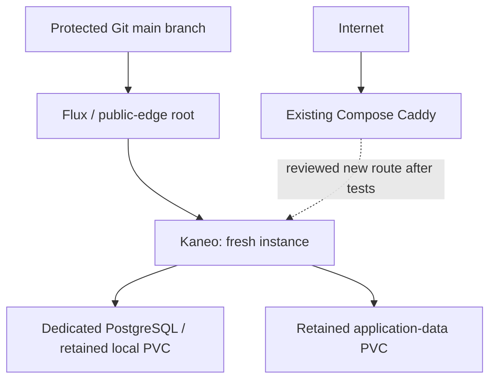

# Public K3s foundation: a new Kaneo instance

Scope revised 2026-11-09. No host has been installed or changed by this branch.
This first change introduces only a public cluster and an independent, empty
Kaneo instance. All existing services, including private Compose Kaneo, retain
their current Compose deployments, routes, credentials and data.

The [migration roadmap](roadmap.md) preserves the decisions and acceptance
criteria from both supplied handoffs. Narrowing this MR does not discard the
future private cluster or the single-server public serving-continuity goal.

## Initial topology

| Component | Initial placement | State |
| --- | --- | --- |
| public-edge | server-2, existing public VPS | One K3s server, also running workloads; SQLite datastore |
| Flux | public-edge | Source and Kustomize controllers; read-only Git deploy identity |
| Kaneo | public server | One replica, new credentials and application-data PVC |
| PostgreSQL 16 | public server | Dedicated Kaneo database and separate PVC |
| Public ingress | Existing Compose Caddy on server-2 | Optional new Kaneo route after local acceptance |

A K3s server already runs the agent components needed to host Pods. Do not
install a second agent service on this machine. No worker enrollment, provider
provisioning, private-cluster bootstrap or Compose service migration is included.

## Coexistence and networking

K3s uses its own containerd. Traefik and ServiceLB are disabled so the existing
Compose Caddy keeps ports 80/443. This change installs no ingress controller,
LoadBalancer, NodePort, hostPort or hostNetwork workload. Kaneo and PostgreSQL
have ClusterIP Services. First access uses an administrator's loopback-only
port-forward. A later operator step adds only the new Kaneo hostname to Caddy,
using the same-host ClusterIP path; it does not replace existing routes.

Discover host routes, Docker networks, LAN/VPN ranges and spare resources
before selecting Pod/Service CIDRs or installing anything. The API must be
reachable only through approved administrative access and firewalls; setting
node-ip or tls-san alone does not restrict its listener. An existing Tailscale
connection may provide workstation administration. Public inter-node networking
will not use Tailscale. No cross-node path is implemented in this single-node
step; choose and test a documented K3s multi-cloud option before adding agents.
Initial Flannel VXLAN is local to this one node; never expose UDP 8472 publicly.

## GitOps and bootstrap ordering

The public root reconciles exactly its own source/controllers and Kaneo. Git
URL, deploy key, age private key, database password, auth secret and application
origin are external bootstrap inputs. Source artifacts include only the public
root, Kaneo and Flux paths. Git credentials have no write permission. Keep main
protected; controllers use strict substitution and reject cross-namespace
references/remote bases. No image automation is installed.

The operator installs controllers, prepares the namespace, dedicated Secrets,
URL ConfigMap, storage-owner label and recovery copies, then applies the Git
sync. Kaneo is active in Git: starting root reconciliation deploys it without a
second activation PR. Missing inputs are a bootstrap error, not a reason to add
placeholder secrets. A feature branch is validated locally; live bootstrap
tracks reviewed main. Rehearse against a separate disposable repository if main
does not yet contain these files.

Credentials initially remain operator-managed. Kaneo's reconciler supports
SOPS/age once encrypted resources are deliberately added to its path. Plain
Kubernetes Secrets are base64, not encryption. Protect the public age key and
server token outside Git and test their recovery. A future private cluster must
use separate identities, keys, tokens, kubeconfigs and backups.

## Runtime, persistence and exposure

Kaneo and PostgreSQL use one replica, Recreate rollouts, non-root restricted
runtime settings, health probes and bounded resources. Images retain the
previously rehearsed versions and multiarchitecture digests. This is a new
instance, with no import or reuse of existing private Kaneo content or secrets.

Both Deployments require the public-cluster label and the kaneo-storage label.
Apply storage ownership to exactly one inspected node. Retain local-path PVCs
with WaitForFirstConsumer bind data to that node. Adding an ARM agent provides
compute capacity; it does not replicate this data or move Kaneo automatically.

Default-deny policies allow Kaneo only cluster DNS and its own PostgreSQL.
SMTP, OAuth, webhooks, object storage and other integrations are out of scope.
Claim the first administrator through local access before exposing the app;
DISABLE_REGISTRATION does not prevent first-account bootstrap. Public use also
requires tested authentication, a coherent backup/restore and reviewed DNS/TLS.
Existing Compose backup discovery does not automatically protect these PVCs.

## Later changes

1. Private/home cluster with one simple pilot, independently secured.
2. Public agents after validating routing, firewall rules, MTU, NetworkPolicy
   enforcement and ARM runtime compatibility. No public worker joins the
   private cluster or receives private-cluster credentials.
3. Public application-serving continuity during a temporary server VPS outage:
   pre-existing app/ingress replicas on surviving agents, external failover and
   surviving data/runtime dependencies. Keep one control-plane server unless
   outage tests or new requirements justify HA. The current local Kaneo data
   and same-host Caddy do not satisfy that future goal.
4. Migrate other services individually, with hardware/storage ownership and
   restore tests. Keep Docker-managing apps in Compose until a supported path
   exists.

See [bootstrap](bootstrap.md), [new Kaneo setup and recovery](kaneo.md), and
the [public-cluster test walkthrough](testing.md). Fleet capacity, real routes,
DNS/TLS, RPO/RTO and backup scheduling remain operator inputs. This branch
does not claim public deployment or fault tolerance.
