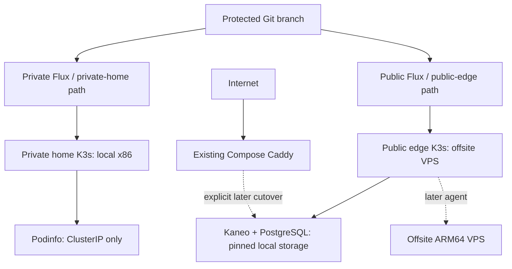

# Two-cluster K3s foundation

Status: initial implementation, 2026-11-08. Nothing has been installed or cut over.
This RFC adapts the supplied migration handoff to the current Compose inventory.

## Scope and placement

| Cluster | Initial server | Workload in this change | Later capacity |
| --- | --- | --- | --- |
| private-home | server-1, local x86_64 | Podinfo, a disposable private GitOps pilot | Trusted local x86 nodes; optional node-pinned NAS workloads |
| public-edge | server-2, existing public VPS | Kaneo + dedicated PostgreSQL 16, initially suspended | Other offsite VPS agents, including a future OCI ARM64 agent |

These are independent Kubernetes trust domains with separate APIs, tokens,
kubeconfigs, Flux deploy keys, SOPS age keys, and backup credentials. No node
joins both. The initial public cluster is entirely offsite; no LAN worker,
inter-cluster routing, provider provisioning, or distributed etcd is introduced.
An extra ARM agent adds capacity, not control-plane or storage availability.
Both initial servers use K3s's single-server SQLite datastore.

## Coexistence and networking

Keep every existing Compose definition, listener, backup, and route active.
K3s uses its own containerd, not Docker. Disable Traefik and ServiceLB so K3s
claims neither 80/443 nor Compose ports. Do not install an ingress controller,
LoadBalancer, NodePort, hostPort, or hostNetwork workload in this change.
Both pilot Services are ClusterIP; operator port-forward binds loopback.

Choose nonoverlapping Pod and Service CIDRs *after* inspecting host routes,
Docker networks, LAN/VPN routes, and future provider ranges. Example CIDRs in
provisioning are illustrative, not an asserted network inventory. Restrict the
K3s API to approved Tailscale sources with the host/provider firewall, keep
6443 closed to the internet, and retain K3s NetworkPolicy enforcement. Flannel VXLAN
is sufficient for the initial single-node clusters. Never open UDP 8472 to the
internet. Tailscale remains a host prerequisite, outside Kubernetes.

Adding any node is a separate change: select and rehearse a supported CNI
path across the actual VPS networks, including MTU, DNS, policy enforcement,
pod-to-pod return traffic and direct/DERP behavior. Do not assume host-level
Tailscale reachability provides pod networking. There is deliberately no ready
to run cross-provider join command or public home worker in this PR.

## GitOps, configuration, and storage

One Flux instance reconciles each cluster root. Pinned, vendored Flux 2.10.0
source/kustomize controllers are shared as manifests, installed independently.
Each root includes its own Git source and root reconciliation. A host-local
`cluster-settings` Secret supplies the Git URL through strict Flux substitution;
no deployment identity is baked into public Git. Independent read-only Git
deploy keys grant no Git push permission.
Sharing a repository still shares a supply-chain boundary: protect main and
require configuration/secret checks. There is no remote kubeconfig in Flux.

Only Podinfo is immediately reconciled. Public Kaneo reconciliation is
suspended in Git until operator preparation is complete. No placeholder
password, domain, address, or database is deployed. Kaneo references a
precreated Secret and URL ConfigMap. They initially remain operator-managed;
SOPS encryption can take over only after independent age keys and a tested
recovery copy exist. The Kaneo reconciler is already configured to decrypt
with its own cluster's `sops-age` Secret. No private identity belongs in public
Git, including unencrypted URLs. Never share either age private key.

Kaneo and PostgreSQL use single replicas, Recreate rollouts, required node
selection, and a Retain local-path StorageClass. The operator labels exactly
one public server as their storage owner. PV node affinity keeps disks on
that node; adding ARM compute does not move state. Both images are pinned to
multiarchitecture index digests. Keep Kaneo at the existing Compose release
2.47.1 for the first restore; upgrading the application is separate work.

Default-deny ingress/egress policies isolate the pilots. Kaneo may reach only
cluster DNS and its own PostgreSQL. Integrations, SMTP, webhooks, external
storage and private APIs require separately reviewed exceptions. Public
exposure needs application auth, a claimed initial administrator, verified
backups, and a deliberately configured ingress path. No existing Kaneo data
is copied automatically.

## Implementation and follow-up PRs

1. **This branch:** provisioning examples, distinct Flux roots, private pilot,
   paused public Kaneo, offline validation, and operator runbooks.
2. **Bootstrap rehearsal:** discover host/network/storage capacity; install
   one server per cluster; generate and review Flux bootstrap manifests with
   separate identities; verify reconciliation and negative reachability tests.
3. **Kaneo cutover:** restore an application-consistent copy, claim/test auth,
   prove backup/restore, add a reviewed Caddy-to-cluster path, and switch only
   Kaneo. Preserve the old Compose recovery set.
4. **Additional public agents:** validate cross-provider CNI and ARM runtime,
   then enroll the future VPS without granting private-cluster access.
5. **Incremental migration:** one service per PR. NAS/hardware workloads stay
   with their owning hardware. Docker-managing applications stay in Compose
   until a supported migration exists.

RTO/RPO, host resources, real network addresses, storage capacity, DNS/TLS,
backup schedule/retention, and future VPS availability remain operator inputs.
No production readiness, HA, provider eligibility, or successful restore is
claimed by rendering manifests.
